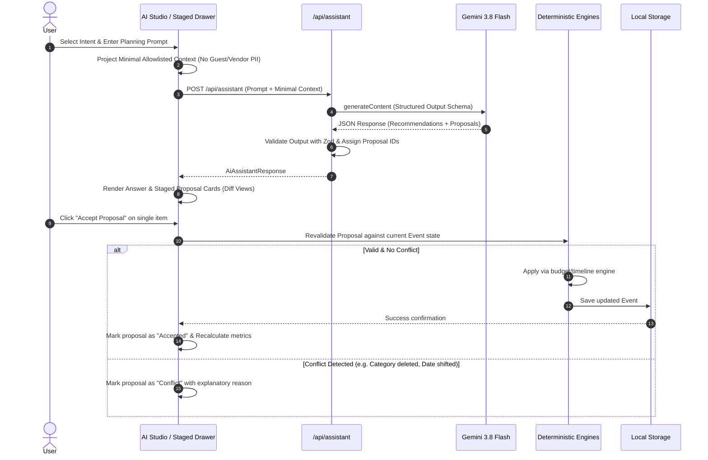

# Milestone 4 Specification — Gemini-Powered Planning Assistant & Staged Proposals

## 1. Context & Architecture Findings

Event Pilot is an India-first, local-first celebration planner built with Next.js App Router, TypeScript, and Tailwind CSS.
- **Milestones 0–3 Live Baseline:**
  - Milestone 1: Core event domain, local-first storage adapter, and sample sandbox.
  - Milestone 2: Budget ledger (category allocations, variance tracking, strict actual spending rule) and timeline tasks matrix (relative day offsets, date reanchoring preserving overrides).
  - Milestone 3: Vendor management book (quoted vs agreed commitments vs deposits), guest & RSVP register (household groups, plus-ones, dietary restrictions), and practical seating planner (table capacities 1-50, occupancy meters, overflow warnings).
  - 100% test coverage baseline: 15 test files, 109 unit and integration tests passing.
- **Architectural Seam for Milestone 4:**
  - AI Assistant is currently designated as `tab: 'ai'` in `WorkspaceNavigation.tsx`, rendering `ModulePlaceholder.tsx`.
  - In Milestone 4, this becomes a full interactive assistant studio (`AiAssistantTab.tsx` / Staged Proposal Drawer) backed by a secure server-side API route (`src/app/api/assistant/route.ts`).
  - Strict Rule: **Gemini proposes. Event Pilot validates. The user decides. The application applies.** The model is never given execution authority over storage, math, or persistent entities.

---

## 2. Security & Environment Configuration

### A. Secret Isolation
- The live Gemini API key is stored exclusively in `.env.local` (`GEMINI_API_KEY`).
- `.env.local` is matched by `.gitignore` (`.env*.local`) and is never committed.
- `.env.example` contains only a fake placeholder: `GEMINI_API_KEY=your_gemini_api_key_here` and `GEMINI_MODEL=gemini-3.8-flash`.
- No client-side `NEXT_PUBLIC_GEMINI_API_KEY` exists. The key is accessed solely on the server inside `src/features/ai/` and API route handlers.
- Secrets are stripped from all diagnostic, error, and console output.

### B. Model Specification
- Exact Model ID: `gemini-3.8-flash`.
- No silent fallback to other models. If `gemini-3.8-flash` experiences transient 503 service spikes or downtime, Event Pilot provides clear user-facing feedback with a retry action and degrades gracefully without disrupting core planning modules.

---

## 3. Privacy-Safe Context Projector (`src/features/ai/context-projector.ts`)

To ensure absolute user privacy and data minimization, the client/server boundary projects an allowlisted summary. The complete event object is NEVER serialized or transmitted to Gemini.

### A. Allowlisted Event Context Fields (Projected on demand based on Intent)
- `eventType`: The celebration archetype (`wedding`, `birthday`, `community`).
- `title`: Event name.
- `date`: Target celebration date (`YYYY-MM-DD`).
- `locationCity`: City / general region extracted from location string (e.g., "Bengaluru").
- `currency`: Active event currency code (`INR`, `USD`, etc.).
- `budgetCap`: Total financial cap.
- `categorySummary`: Array of `{ name: string, allocatedAmount: number }` (only when intent is `budget` or `general`).
- `expectedAttendance`: Single integer representing total confirmed attendees (named + plus-ones) (only when intent is `guests` or `general`).
- `culturalContext`: Optional theme/notes explicitly set by user.

### B. Prohibited Fields (Strictly Excluded by Architecture & Unit Tested)
- Guest names, phone numbers, email addresses.
- Household names, relationships, personal notes.
- Dietary preferences, food allergies, medical requirements.
- Full vendor directory records, contact phone/email, private contract terms.
- Milestone 2 itemized expenses or actual bank spending records.
- Raw browser localStorage data, tokens, keys.

---

## 4. Schemas & Proposal Contracts (`src/features/ai/types.ts` & `src/features/ai/schemas.ts`)

### A. Request Contract (`AiAssistantRequest`)
```ts
export type AssistantIntent = 'ideas' | 'budget' | 'timeline' | 'vendors' | 'guests' | 'general';

export interface AiAssistantRequest {
  eventId: string;
  intent: AssistantIntent;
  userPrompt: string;
  context: ProjectedEventContext;
}
```

### B. Staged Proposal Contract (`StagedProposal`)
Supported discriminated proposal action types:
1. `add_task`: Propose a new planning task with recommended due date offset and priority.
2. `add_milestone`: Propose a missing milestone phase (e.g., "T-45 Days: Invitation Dispatch").
3. `adjust_budget_allocation`: Propose shifting an allocated amount between existing budget categories or creating a contingency category.
4. `add_checklist_item`: Propose a vendor research checklist item or day-of logistics item.
5. `suggest_vendor_followup`: Propose interview questions or contract checklist items for a vendor category.

Each proposal payload is strictly typed:
```ts
export interface StagedProposal {
  id: string; // Deterministic client/server assigned ID (e.g. `prop-1`, `prop-2`)
  actionType: ProposalActionType;
  title: string;
  explanation: string;
  assumptions?: string;
  potentialImpact?: string;
  status: 'staged' | 'accepted' | 'dismissed' | 'conflict';
  conflictReason?: string;
  payload: ProposalPayload; // Validated discriminated union
}
```

### C. Response Contract (`AiAssistantResponse`)
```ts
export interface AiAssistantResponse {
  answer: string;
  summary: string;
  recommendations: string[];
  proposals: StagedProposal[];
  modelUsed: string;
  timestamp: string;
}
```

---

## 5. Review-First Staged Workflow & Deterministic Application



### Application Guardrails:
1. **Budget Invariant:** Budget adjustments never create `Expense` items or assume actual spending. Allocations are re-verified using `calculateBudgetSummary`.
2. **Timeline Invariant:** Proposed tasks never overwrite existing tasks or manual date overrides (`isDueDateOverridden: true`). They are added with generated IDs using `calculateMilestoneDate`.
3. **Vendor Invariant:** Recommendations cannot fabricate real supplier contact details or legal contracts.
4. **Guest Invariant:** Gemini cannot assign individual guests to tables or alter private dietary records.

---

## 6. Resilience, Graceful Degradation & Error Mapping

| Scenario | HTTP Status | User Message | Application Behavior |
|---|---|---|---|
| Model High Demand (503) | 503 | "Gemini 3.8 Flash is currently experiencing high demand. Please try again shortly." | Workspace operational; retry button enabled |
| Missing API Key | 500 / 401 | "AI Assistant is not configured. Please supply a valid GEMINI_API_KEY in .env.local." | Manual planning features unaffected |
| Quota Exceeded (429) | 429 | "AI service quota temporarily reached. Please wait a moment before trying again." | Retry with backoff; existing data safe |
| Invalid JSON from Model | 502 | "The assistant received an unformatted response. No changes were staged." | Zero event corruption; safe fallback |
| Offline / Network Error | 503 | "Network connection to AI services unavailable. Check your internet connection." | Event Pilot continues running 100% locally |

---

## 7. Testing Plan

- **Context Projection Tests (`context-projector.test.ts`):** Assert that passing a full sample event (with 14 guests, phone numbers, dietary notes, vendor contracts) returns an object with ZERO guest PII, ZERO personal notes, and ZERO full vendor records.
- **Schema Validation Tests (`schemas.test.ts`):** Test Zod validation of proposals, rejection of invalid actions, negative amounts, malformed JSON, and unexpected fields.
- **Provider & Route Tests (`route.test.ts`):** Mock Gemini API responses to test successful structured output, error handling (503, 429, 401), and payload sanitation without leaking keys.
- **Proposal Dispatcher Tests (`proposal-engine.test.ts`):** Test applying a budget proposal via `budget-engine`, applying a task via `timeline-engine`, detecting stale/conflicting proposals, and dismissing proposals without mutating state.
- **Component Tests (`AiAssistantTab.test.tsx`):** Test prompt submission, loading states, rendering staged cards, accepting one proposal while dismissing another, and error displays.
- **Regression Suite:** Re-run all 109 tests from Milestones 1–3 to ensure 100% passing baseline.

---

## 8. Impeccable Design Audit Plan

- Run `.\.agents\skills\impeccable\scripts\impeccable.cmd detect src`
- Verify typography (`font-display: Eczar`, `font-sans: Plus Jakarta Sans`, `font-mono: JetBrains Mono`).
- Verify color tokens: `#D97706` marigold amber, `#B45309` burnished ochre, `#FDFBF7` ivory ground, `#1C1917` deep ink text.
- Ensure proposal cards feature clear visual distinction:
  - Staged card: Border terracotta wash with "PROPOSED CHANGE" badge.
  - Accepted card: Forest green subtle wash with "APPLIED TO EVENT" badge.
  - Dismissed card: Neutral muted outline.
  - Conflict card: Warning amber wash with specific reason.
