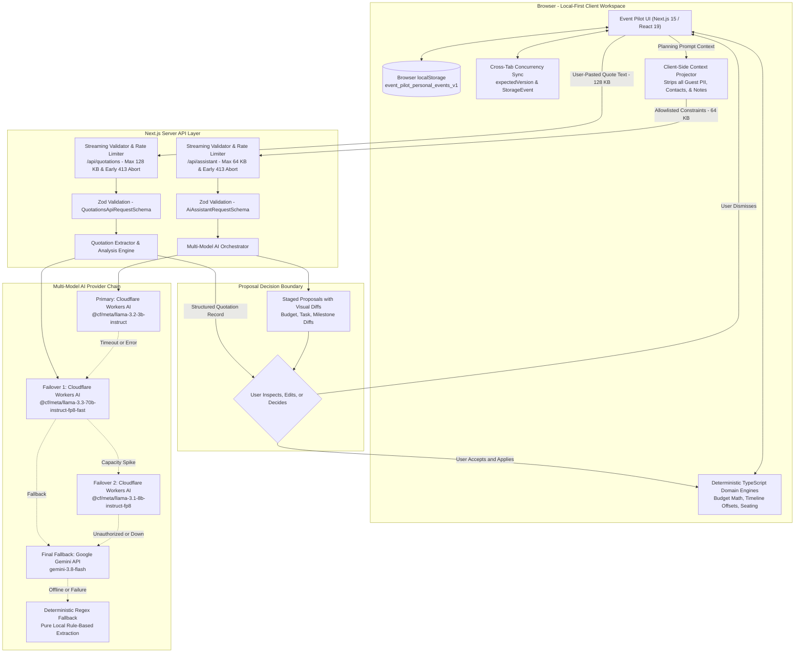

# Event Pilot

> **An inclusive, editorial celebration planning studio inspired by the wisdom and order of an Indian almanac.**  
> Built for **Prompt Wars Challenge 5 — Celebration & Event Planner**.

[](https://nextjs.org/)
[](https://www.typescriptlang.org/)
[](https://tailwindcss.com/)
[](https://vitest.dev/)
[](LICENSE)

---

## 1. Overview & First Screen

Planning milestone celebrations—especially multi-day Indian weddings, landmark birthdays, or community festivals—is notoriously fragmented. Organizers are forced to juggle chaotic spreadsheets, disconnected messaging threads, scattered PDF quotes, and unorganized notes.

**Event Pilot** bridges modern AI assistance with deterministic application authority:

```
┌────────────────────────────────────────────────────────────────────────┐
│                        THE CORE PRINCIPLE                              │
│                                                                        │
│   The model proposes.     The engine validates.     The user decides.  │
│      (Generative AI)         (TypeScript Logic)        (Human Authority)│
└────────────────────────────────────────────────────────────────────────┘
```

- **Deterministic Domain Authority:** All financial totals, category variances, per-guest scaling, and calendar date re-anchorings are computed in 100% pure TypeScript logic. Generative language models are strictly prohibited from calculating authoritative numbers or dates.
- **Privacy-Safe Context Projection:** Before leaving the browser, the planning assistant extracts only allowlisted celebration constraints (title, city, budget cap, headcount, category names). Guest identities, contact information, dietary restrictions, and private storage are never transmitted to external AI providers.
- **Local-First Privacy:** All personal celebration data lives inside the browser's `localStorage` (`event_pilot_personal_events_v1`). No mandatory accounts, cloud databases, or third-party tracking are required.
- **Resilient Multi-Model AI Chain:** Primary orchestration runs on Cloudflare Workers AI free-tier models with automatic multi-model failover, backed by Google Gemini Flash as an isolated final fallback.

---

## Table of Contents

1. [Overview & First Screen](#1-overview--first-screen)
2. [The Product Story](#2-the-product-story)
3. [Celebration Archetypes](#3-celebration-archetypes)
4. [Comprehensive Feature Showcase](#4-comprehensive-feature-showcase)
5. [AI Architecture & Privacy-Conscious Data Flow](#5-ai-architecture--privacy-conscious-data-flow)
6. [Software Architecture & Engineering Highlights](#6-software-architecture--engineering-highlights)
7. [Challenge 5 Evaluator Mapping & Guided Tour](#7-challenge-5-evaluator-mapping--guided-tour)
8. [Technology Stack](#8-technology-stack)
9. [Installation & Local Setup](#9-installation--local-setup)
10. [Testing & Quality Verification](#10-testing--quality-verification)
11. [Known Limitations & Operational Notes](#11-known-limitations--operational-notes)
12. [Open Source License](#12-open-source-license)

---

## 2. The Product Story

Celebration planning is uniquely emotional, culturally intricate, and financially demanding. When a couple prepares for a traditional Vivaha, they coordinate multiple ceremonies (Muhurtham, Sangeet, Mehendi, Reception), manage multi-tiered guest hospitality, balance fixed mandap deposits with variable catering heads, and navigate sensitive seating requirements. 

Generic AI chatbots fail in this context: they hallucinate arithmetic, invent calendar dates without considering leap years or month boundaries, and silently overwrite human decisions.

**Event Pilot is not an autonomous bot or a generic marketplace.** It is an **Almanac-inspired planning atelier** that honors human agency:

1. **Structured Proposals Over Conversational Banter:** The assistant generates atomic, inspectable proposals (`adjust_budget_allocation`, `add_task`, `add_milestone`, `suggest_vendor_followup`).
2. **Side-by-Side Diffs:** Organizers view exact side-by-side proposal diffs before accepting, editing, or dismissing changes.
3. **Optimistic Concurrency & Safe State:** Background tab updates and storage changes are synchronized automatically with version locking (`expectedVersion`) to eliminate data overwrites.

---

## 3. Celebration Archetypes

Event Pilot adapts its ceremonial structures, milestone offsets, and financial allocations to three distinct celebration archetypes:

```
┌────────────────────────────────────────────────────────────────────────┐
│                        CELEBRATION ARCHETYPES                          │
├────────────────────┬────────────────────┬──────────────────────────────┤
│ Vivaha & Weddings  │ Milestone Birthday │ Community Festival           │
├────────────────────┼────────────────────┼──────────────────────────────┤
│ Multi-day rituals  │ Focused single-day │ Multi-tier volunteer matrix  │
│ High vendor counts │ Entertainment & DJ │ Civic & police permits       │
│ Family households  │ Bespoke cake craft │ Tiered community allocations │
│ Dietary management │ Curated favor sets │ Public timeline broadcasts   │
└────────────────────┴────────────────────┴──────────────────────────────┘
```

- **Vivaha & Weddings:** Deep ceremonial support featuring multi-ritual schedules, high vendor density (mandap, priest, shehnai, photography), household invitation hierarchies, and sensitive table seating.
- **Milestone Birthdays:** Single-day party coordination focused on venue exclusivity, entertainment milestones, thematic decor, cake logistics, and dietary tracking.
- **Community Festivals:** Civic ground bookings, volunteer task matrices, municipal permissions, safety checklists, and tiered fund allocations.
- **Resettable Sample Sandbox:** Includes a complete, pre-configured sandbox celebration (*Aarav & Meera's Vivaha Celebration*) that allows instant exploration without mutating personal saved celebrations.

---

## 4. Comprehensive Feature Showcase

### A. Financial Runway & Budget Ledger
- **Category Allocations & Visual Meters:** Real-time tracking of planned budgets, allocated category limits, estimated amounts, and settled actuals.
- **Strict Actual Spending Rule:** Distinguishes estimated costs from recorded actuals. Vendor contract quotes and agreed commitments are never fabricated as settled expenses.
- **Per-Guest Rate Economics:** Supports both fixed lump-sum costs (venue hire, photography) and dynamic per-guest rates (catering, sweet boxes) that automatically adjust when confirmed guest counts shift.
- **Temporary Undo Toast:** Deleting an expense triggers a 5-second non-blocking toast that enables instant recovery before permanent deletion.
- **Multi-Currency Precision:** Safe integer-precision monetary calculations supporting INR (`₹`), USD (`$`), EUR (`€`), and GBP (`£`) without hazardous floating-point rounding or currency mixing.

### B. Re-Anchoring Timeline & Logistics Matrix
- **Relative Day Offsets:** Milestones are anchored relative to the celebration date (e.g. `T-180` days, `T-30` days, `T+1` day).
- **Rescheduling Safety Engine:** When an event date moves, milestones and dependent tasks automatically recalculate their due dates in pure TypeScript while strictly preserving manual edits, custom descriptions, and completed timestamps.
- **Offline RFC 5545 `.ics` Export:** Generates standard iCalendar `.ics` files client-side with zero external dependencies, ready for Google Calendar, Apple Calendar, and Outlook.
- **Filters & Status Meters:** Filter tasks by priority (`high`, `medium`, `low`) and completion status (`pending`, `completed`, `overdue`).

### C. Vendor Management & Quotation Engine
- **Structured Vendor Registry:** Tracks business names, categories, contact points, agreed contract commitments, and deposits paid.
- **Side-by-Side Quotation Comparison:** Compare competing vendor proposals within a category, analyzing total cost, deliverables, exclusions, hidden taxes, and payment milestones.
- **AI-Assisted Quotation Extraction:** Server-side parsing of messy quotation text into structured, validated JSON records using bounded schemas.
- **Vendor Requirement Briefs & PDF Export:** Generates structured vendor requirement briefs detailing timing constraints, non-negotiables, and cultural nuances, downloadable as a PDF via `jspdf`.
- **Cascading Integrity:** Deleting a vendor cleanly sanitizes foreign keys without deleting associated expense records.

### D. Guest Registry, Hospitality & Seating Planner
- **Household Groupings & Plus-Ones:** Organize guests into household units with individual plus-one allocations and child tracking.
- **Dietary & Religious Observance:** Tracks dietary needs (Vegetarian, Sattvic, Jain, Vegan, Non-Vegetarian) with real-time hospitality counts for caterers.
- **Practical Seating Planner:** Enforces physical table capacity constraints (1 to 50 seats) with live occupancy badges and dynamic overcapacity alerts.
- **Single-Pass Memoization:** Pre-indexed occupancy calculations compute table loads in $O(G + A + T)$ time, preventing UI lag during large wedding seating.
- **Clean Dependency Cleanup:** Deleting a table automatically unassigns seated guests back to the unassigned attendee queue.

### E. Dynamic Replanning & What-If Simulations
- **Consequential Simulation:** Test the downstream effects of shifting celebration dates, increasing guest counts, or altering budget caps before committing changes.
- **Multi-Domain Impact Analysis:** Computes projected financial headroom/deficits, milestone compression warnings, and seating shortages simultaneously.
- **Granular Proposal Selection:** Review individual proposal diffs (`adjust_budget_allocation`, `reschedule_milestones`, `adjust_table_capacity`), select or deselect specific items, and apply approved diffs atomically.

---

## 5. AI Architecture & Privacy-Conscious Data Flow

Event Pilot employs a multi-model fallback chain designed for maximum resilience, strict privacy, and zero math hallucination.

### Provider Priority & Exact Model Identifiers

```
┌────────────────────────────────────────────────────────────────────────┐
│                       MULTI-MODEL PROVIDER CHAIN                       │
├────────────────────────────────────────────────────────────────────────┤
│ 1. Primary Provider: Cloudflare Workers AI                             │
│    Model: @cf/meta/llama-3.2-3b-instruct (Verified Free Tier)          │
│                                                                        │
│ 2. Automated Cloudflare Failovers (Transient Errors / Capacity):       │
│    Failover A: @cf/meta/llama-3.3-70b-instruct-fp8-fast                │
│    Failover B: @cf/meta/llama-3.1-8b-instruct-fp8                      │
│                                                                        │
│ 3. Isolated Final Fallback: Google Gemini API                          │
│    Model: gemini-3.8-flash                                             │
└────────────────────────────────────────────────────────────────────────┘
```

- **Strict Isolation:** If Cloudflare Workers AI succeeds, Google Gemini is never invoked. Gemini is engaged only if all Cloudflare candidates fail, time out (30s bound), or lack credentials.
- **Graceful Degradation:** If all external providers fail or credentials are omitted, the application returns a structured, actionable 503 response. The entire manual planning suite remains fully functional offline.

### Privacy Architecture & Request Boundary Audit

Event Pilot enforces distinct, verified privacy guarantees across its two server AI pathways:

#### 1. Planning Assistant Pathway (`/api/assistant`)
- **Client-Side Context Projection:** Before any network dispatch leaves the browser, `projectPrivacySafeContext()` ([`src/features/ai/context-projector.ts`](src/features/ai/context-projector.ts)) extracts strictly allowlisted celebration metadata: event archetype, celebration title, location/city, budget cap, target headcount, and category allocation names.
- **Strictly Excluded PII:** Zero guest records (names, email addresses, phone numbers, dietary requirements, attendance statuses, table assignments), zero private vendor notes, and zero raw `localStorage` payloads ever leave the browser.
- **Bounded Request Size:** The streaming rate limiter enforces `MAX_ASSISTANT_BODY_BYTES = 64 * 1024` (64 KB) with early HTTP 413 abort before complete payload buffering.

#### 2. Quotation Extraction Pathway (`/api/quotations`)
- **User-Initiated Scope:** Operates solely on raw text that the user explicitly pastes into the quotation import modal.
- **Payload Isolation:** The server transmits up to 8,000 characters of this user-pasted quotation text solely to extract pricing, deliverables, taxes, and payment milestones. Stored celebration records, guest rosters, and budget ledgers are never attached.
- **Bounded Request Size:** The streaming rate limiter enforces `MAX_QUOTATION_BODY_BYTES = 128 * 1024` (128 KB) with early HTTP 413 abort.
- **Deterministic Offline Fallback:** If AI credentials are not provided or remote providers fail, quotation extraction falls back to a deterministic, local regex and pattern-matching parser (`extractQuotationDeterministically`) that executes entirely on the server without any external API calls.

#### 3. Storage Boundary
- **Local-First Client Authority:** All personal celebrations are stored in the browser's `localStorage` (`event_pilot_personal_events_v1`). No cloud database, user account creation, or external telemetry is required.

### Data Flow Architecture



---

## 6. Software Architecture & Engineering Highlights

Event Pilot is engineered with deep modules, strict boundary contracts, and resilient error recovery:

- **Deep Module Architecture:** Key capabilities are encapsulated behind minimal interfaces. [`useEventWorkspace`](src/features/events/useEventWorkspace.ts) manages persistence, optimistic version locking, and cross-tab reconciliation behind a clean hook. [`useUndoAction`](src/hooks/useUndoAction.ts) isolates staged deletion queues and timer lifecycles.
- **Optimistic Concurrency Protection:** Personal celebrations track `version` and `updatedAt`. Saving operations pass `expectedVersion` to prevent silent overwrites when multiple browser tabs are open, surfacing a non-destructive conflict banner when background changes are detected.
- **Early-Abort Streaming Request Limits:** The API enforces strict size boundaries (64 KB for assistant, 128 KB for quotations) chunk-by-chunk using a `ReadableStreamDefaultReader`. If a stream exceeds the limit, it cancels the stream immediately and returns HTTP 413 without buffering excess bytes into server memory.
- **Verified Accessibility Improvements (4.69:1 Contrast & ARIA):**
  - "Skip to main content" link visible on keyboard focus for rapid keyboard navigation.
  - Primary amber button contrast elevated to **4.69:1** (`text-neutral-text` on `#D97706`), meeting the WCAG AA 4.5:1 minimum threshold for standard text.
  - Strengthened keyboard focus rings and darker dietary badge text for contrast.
  - Corrected heading hierarchy in the quotation comparison view.
  - `aria-invalid` and `aria-describedby` on all dialog form inputs for programmatic error association.
  - Active workspace navigation rail state communicated via `aria-current="page"`.
  - In-page view switchers implemented with standard `role="tablist"`, `role="tab"`, and `role="tabpanel"`.
  - Cost-model switchers structured as accessible `role="radiogroup"` controls with roving tabindex and Arrow-key navigation.
  - Global hotkeys (1–7) are automatically isolated when modal dialogs are open.

---

## 7. Challenge 5 Evaluator Mapping & Guided Tour

### Challenge 5 Capability Mapping

| Challenge Need | Event Pilot Capability | Implementation Evidence |
|---|---|---|
| **Multi-Ceremony & Event Planning** | Three tailored archetypes (Weddings, Birthdays, Festivals) with distinct ceremonial milestones and budgets. | [`src/features/events/types.ts`](src/features/events/types.ts), [`src/components/events/EventCreateDialog.tsx`](src/components/events/EventCreateDialog.tsx) |
| **Budget Control & Actuals** | Deterministic ledger with category allocations, fixed vs per-guest unit economics, and strict actual spending rules. | [`src/features/events/budget-engine.ts`](src/features/events/budget-engine.ts), [`src/components/budget/BudgetLedgerTab.tsx`](src/components/budget/BudgetLedgerTab.tsx) |
| **Rescheduling & Logistics** | Relative milestone offsets (`T-X`), rescheduling safety engine, and offline RFC 5545 `.ics` calendar export. | [`src/features/events/timeline-engine.ts`](src/features/events/timeline-engine.ts), [`src/features/timeline/ics-export.ts`](src/features/timeline/ics-export.ts) |
| **Vendor Quotes & Coordination** | Structured vendor registry, comparative quotation analysis, AI quote extraction, and PDF brief generation. | [`src/features/vendors/quotations/`](src/features/vendors/quotations/), [`src/components/vendors/`](src/components/vendors/) |
| **Guest Hospitality & Seating** | Household invitation groups, dietary observance tracking, table capacity constraints, and $O(G+A+T)$ occupancy. | [`src/features/guests/guest-engine.ts`](src/features/guests/guest-engine.ts), [`src/features/seating/seating-engine.ts`](src/features/seating/seating-engine.ts) |
| **Generative AI Assistance** | Privacy-safe context projection, multi-model fallback chain (Cloudflare $\rightarrow$ Gemini), and staged proposal review. | [`src/features/ai/ai-orchestrator.ts`](src/features/ai/ai-orchestrator.ts), [`src/components/ai/AiAssistantTab.tsx`](src/components/ai/AiAssistantTab.tsx) |
| **What-If Consequence Planning** | Real-time dynamic replanner simulating downstream impacts of date shifts, headcount increases, and budget adjustments. | [`src/features/replanning/replanning-engine.ts`](src/features/replanning/replanning-engine.ts), [`src/components/replanning/`](src/components/replanning/) |

### 5-Minute Evaluator Tour

Follow these verified steps in the running application (`http://localhost:3000`):

1. **Explore the Sample Sandbox:** On the landing hero, click **"Explore Sample Event"**. Inspect *Aarav & Meera's Vivaha Celebration* across the 7 workspace navigation tabs without creating an account.
2. **Review the Budget Ledger:** Switch to the **Budget Ledger** tab (hotkey `2`). Notice the distinction between allocated limits, estimated commitments, and recorded actuals. Record an expense or toggle an item to test per-guest headcount scaling.
3. **Run What-If Replanning:** Click **"Dynamic Replan"** in the budget header. Slide target attendance from 250 to 350. Review the multi-domain impact analysis (budget variance, task compression, seating shortages) and inspect the selective proposal diffs.
4. **Inspect Dietary & Seating Logistics:** Switch to **Guests & RSVP** (hotkey `5`) to review dietary preferences (Vegetarian, Sattvic, Jain). Then open **Seating Planner** (hotkey `6`) to inspect table occupancy meters, assign attendees, or test overcapacity warnings.
5. **Compare Vendor Quotations:** In the **Vendors** tab (hotkey `4`), click **"Compare Quotes"**. Review side-by-side pricing, included deliverables, and payment terms, or click **"Requirement Brief"** to generate an offline PDF summary.
6. **Export Offline Calendar:** In the **Timeline & Tasks** tab (hotkey `3`), click **"Export Calendar (.ics)"** to download an RFC 5545 `.ics` file containing all re-anchored celebration milestones.

---

## 8. Technology Stack

| Layer | Technologies & Libraries | Purpose in Event Pilot |
|---|---|---|
| **Application Framework** | [Next.js 15.1](https://nextjs.org/) (App Router, React 19) | Server components, API routes, fast client navigation |
| **Language & Typing** | [TypeScript 5.7](https://www.typescriptlang.org/) (Strict Mode) | Strict typing across domain models, zero `any` in production code |
| **Styling & Design** | [Tailwind CSS 3.4](https://tailwindcss.com/) | Panchang & Utsav Almanac design tokens (`DESIGN.md`) |
| **Typography** | `Eczar` & `Plus Jakarta Sans` | Self-hosted Google Fonts via `next/font/google` eliminating FOUC |
| **Schema Validation** | [Zod 4.6](https://zod.dev/) | Runtime contract enforcement for API routes and proposals |
| **Document Generation** | [jsPDF 4.2](https://github.com/parallax/jsPDF) | Client-side vendor requirement brief PDF generation |
| **Icons & Visuals** | [Lucide React 0.469](https://lucide.dev/) | Consistent, accessible iconography |
| **Primary AI Provider** | [Cloudflare Workers AI](https://developers.cloudflare.com/workers-ai/) | Verified free-tier Llama 3 models with server-side failover |
| **Fallback AI Provider** | [Google Gemini API](https://ai.google.dev/) (`@google/genai` 2.30) | Isolated final fallback adapter (`gemini-3.8-flash`) |
| **Testing Framework** | [Vitest 2.1](https://vitest.dev/), Testing Library | Unit, integration, and UI workflow regression test suites |
| **Local Persistence** | Browser `localStorage` | Private, account-free local storage with version locking |

---

## 9. Installation & Local Setup

### Prerequisites
- **Node.js:** `18.x` or higher (tested on Node 20, 22, and 24)
- **npm:** `9.x` or higher

### Step 1: Clone Repository
```bash
git clone https://github.com/rahulasthwik1307/EventPilot.git
cd EventPilot
```

### Step 2: Install Dependencies
```bash
npm install
```

### Step 3: Configure Environment Variables
Copy the example environment file:
```bash
cp .env.example .env.local
```

Edit `.env.local` to configure AI providers:
```bash
# ==========================================
# Primary AI Provider: Cloudflare Workers AI
# Verified free tier: 10,000 Neurons/day
# ==========================================
CLOUDFLARE_ACCOUNT_ID=your_cloudflare_account_id_here
CLOUDFLARE_API_TOKEN=your_cloudflare_api_token_here
CLOUDFLARE_MODELS=@cf/meta/llama-3.2-3b-instruct,@cf/meta/llama-3.3-70b-instruct-fp8-fast,@cf/meta/llama-3.1-8b-instruct-fp8
CLOUDFLARE_TIMEOUT_MS=30000

# ==========================================
# Fallback AI Provider: Google Gemini API
# Server-side provider adapter / final fallback
# ==========================================
GEMINI_API_KEY=your_gemini_api_key_here
GEMINI_MODEL=gemini-3.8-flash
```

> **Offline Mode Note:** If you do not configure AI credentials, Event Pilot will run completely in **Offline Manual Planning Mode**. All budgets, timelines, seating, guests, vendor books, offline `.ics` exports, and sample sandboxes remain 100% operational. Only the AI Assistant and AI quotation extraction routes will indicate that provider credentials are unconfigured.

### Step 4: Run Development Server
```bash
npm run dev
```

Open [http://localhost:3000](http://localhost:3000) in your browser.

---

## 10. Testing & Quality Verification

All quality checks have been verified directly in the project environment:

```bash
# 1. Run Complete Automated Test Suite (53 files, 498 tests)
npm test

# 2. Strict TypeScript Compilation Check
npm run typecheck

# 3. Code Style & ESLint Verification
npm run lint

# 4. Production Next.js Build
npm run build
```

### Verification Results Baseline

```
┌───────────────────────────────────────┬───────────────────────────────────────┐
│ Check                                 │ Verified Result                       │
├───────────────────────────────────────┼───────────────────────────────────────┤
│ Vitest Automated Test Suite           │ 53 passed / 53 files (498/498 tests)  │
│ TypeScript Typecheck (tsc --noEmit)   │ 0 errors (clean exit, code 0)         │
│ ESLint Validation (next lint)         │ 0 warnings, 0 errors (clean exit)     │
│ Production Build (next build)         │ Compiled successfully (all routes)    │
└───────────────────────────────────────┴───────────────────────────────────────┘
```

> **Testing Tooling Note:** Automated coverage tooling (`@vitest/coverage-v8`) was intentionally deferred during testing remediation to avoid adding unpinned packages. All 498 tests execute deterministically against local mocks without consuming external API quotas.
>
> **Testing Highlights:** Recent test coverage additions include thorough unit and regression suites for the **quotation extraction fallback chain** (multi-provider Cloudflare $\rightarrow$ Gemini $\rightarrow$ regex fallback), runtime validation of **quotation schemas**, and type-narrowing safety for **proposal type guards**.

---

## 11. Known Limitations & Operational Notes

- **In-Memory Rate Limiting Scope:** The built-in sliding-window rate limiter runs in-memory per Node process. In multi-instance or serverless containerized environments (e.g. Vercel serverless / AWS Lambda / multi-replica Kubernetes), state is not shared across nodes and resets upon container recycling. Production deployments spanning multiple edge instances should be backed by a centralized store (e.g. Redis, Upstash, or Cloudflare Rate Limiting).
- **Local-First Single-Device Scope:** In accordance with the initial privacy-first release, personal celebration data is stored in the user's browser `localStorage`. Data does not automatically synchronize across different physical devices or separate browsers.
- **Accessibility Verification Scope:** Targeted accessibility remediations—including elevated amber button contrast (measured 4.69:1), WAI-ARIA tablists, radiogroups, and programmatic form error associations—have been verified via automated DOM testing. Application-wide WCAG 2.2 AA certification across every screen and full end-to-end screen reader testing (NVDA, VoiceOver, JAWS) across all operating systems have not been independently certified.

---

## 12. Open Source License

Event Pilot is open-source software licensed under the **[MIT License](LICENSE)**.

```
Copyright (c) 2026 rahulasthwik1307
```
